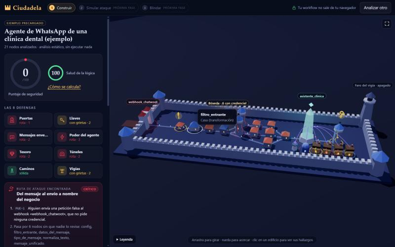

# Ciudadela

Mira tu workflow de n8n como lo vería un intruso, y blíndalo.

Ciudadela audita la seguridad de un workflow de n8n y la hace visible. Convierte el workflow en una ciudadela 3D, muestra por dónde entraría un intruso y genera una versión corregida lista para importar en n8n.

Hecho por Alkyora para el concurso "Built with Fable" de la comunidad Imperio.



## Qué hace

1. **Construir.** Pegas o arrastras el JSON de tu workflow. Ciudadela lo analiza con 33 reglas, calcula un puntaje de seguridad (0 a 100) y otro de salud de la lógica, y levanta la ciudadela: las entradas son puertas en la muralla, la IA es una torre de cristal, las herramientas del agente son talleres y las salidas son torres de vigía.
2. **Simular ataque.** Si hay una ruta de ataque, un intruso entra por la puerta débil y un narrador explica cada paso. Si no la hay, la ciudadela resiste y lo dice.
3. **Blindar.** Genera el workflow corregido, la ciudadela se transforma y el mismo ataque rebota. Puedes descargar el JSON blindado, copiarlo para pegarlo en el canvas de n8n, ver los cambios, descargar el reporte en Markdown y generar una copia limpia para compartir.

Las 8 defensas que revisa: Puertas (autenticación de entradas), Llaves (secretos), Mensajes envenenados (prompt injection), Poder del agente, Tesoro (datos personales y memoria), Túneles (inyección), Caminos (transporte) y Vigías (errores y monitoreo). Además revisa la lógica del flujo.

## Privacidad

- **Tu workflow no sale de tu navegador.** No hay servidor, ni analítica, ni peticiones a terceros. Las librerías van empaquetadas.
- **Sin IA en tiempo de ejecución.** El motor son reglas fijas: el mismo JSON da siempre el mismo resultado.
- **Análisis estático.** Ciudadela nunca ejecuta el workflow ni contacta los servicios que aparecen en él.
- En producción, `netlify.toml` aplica una política de contenido (`connect-src 'self'`) que impide técnicamente que la página contacte otro origen.

## Qué no hace

Ciudadela revisa automáticamente seguridad, confiabilidad y lógica. La efectividad del flujo, su costo y su valor de negocio requieren una revisión humana. Tampoco es una prueba de intrusión: la "simulación de ataque" es una lectura del flujo de datos a partir de los hallazgos.

## Uso local

Requiere Node 23.6 o superior (los scripts importan el motor en TypeScript directamente).

```bash
npm install
```

```bash
npm run dev
```

Abre `http://localhost:5173`.

Otros comandos:

| Comando | Qué hace |
|---|---|
| `npm test` | Pruebas (Vitest): reglas, ejemplos, blindaje, reporte y pruebas de oro |
| `npm run build` | Chequeo de tipos y sitio estático en `dist/` |
| `npm run preview` | Sirve `dist/` para revisarlo antes de desplegar |
| `npm run analizar -- workflow.json` | Reporte en texto en la terminal |
| `node scripts/blindar.mjs workflow.json --salida blindado.json` | Blindaje desde la terminal |
| `npm run estudio` | Regenera `public/estudio.json` con el estudio de plantillas |
| `node scripts/crear-ejemplos.mjs` | Regenera los tres ejemplos |

## Despliegue en Netlify

El repositorio ya incluye `netlify.toml` (comando de build, carpeta de publicación, versión de Node y cabeceras de seguridad).

**Opción A, desde el repositorio**

1. Sube el repositorio a GitHub, GitLab o Bitbucket.
2. En Netlify: "Add new site" → "Import an existing project" y elige el repositorio.
3. Netlify lee `netlify.toml`; no hay que configurar nada más. Pulsa "Deploy".

**Opción B, desde tu computadora**

```bash
npm run build
```

```bash
npx netlify-cli deploy --prod --dir dist
```

**Opción C, sin terminal**

Ejecuta `npm run build` y arrastra la carpeta `dist/` a `https://app.netlify.com/drop`. En este caso las cabeceras de `netlify.toml` no se aplican; para tenerlas usa la opción A o la B.

La carpeta `test-fixtures/privados/` no se versiona ni se despliega.

## El estudio de plantillas

`scripts/estudio-plantillas.mjs` descarga una muestra de la API pública de plantillas de n8n (por defecto, las 300 más vistas y 200 al azar), la analiza con el mismo motor de la web y escribe `public/estudio.json` solo con agregados: sin nombres, autores ni ids. Usa caché en disco (`.cache/plantillas/`) y hace como máximo 2 peticiones por segundo.

```bash
npm run estudio
```

Si `public/estudio.json` no existe, la sección "Lo que encontramos en N plantillas públicas" no aparece en la web.

## Estructura

```
src/engine/     Motor de análisis y blindaje (sin DOM)
src/escena/     Ciudadela 3D (three.js), simulación y vista plano 2D
src/ui/         Interfaz
scripts/        Reporte, blindaje y estudio desde la terminal
public/ejemplos Tres workflows sintéticos y sus hallazgos esperados
tests/          Pruebas
```

Para continuar el desarrollo: `ARQUITECTURA.md` (cómo está hecho), `DECISIONES.md` (qué se decidió y por qué) y `BITACORA.md` (qué se hizo, qué falló y cómo se corrigió).

## Los ejemplos

Los tres workflows de `public/ejemplos/` son sintéticos y originales. Están etiquetados como ejemplos en la interfaz y sus hallazgos esperados están en `public/ejemplos/ESPERADO.md`.

## Vista previa al compartir el link

El sitio incluye etiquetas Open Graph y de X, con la imagen `public/ciudadela-og.jpg`. Esas etiquetas necesitan la dirección pública del sitio:

- En Netlify no hay que hacer nada: el build usa el dominio principal del sitio.
- Si el sitio cambia de dirección, o se publica en otro servicio, define la variable de entorno `URL_DEL_SITIO` (por ejemplo `https://midominio.com`) antes de construir.
- Sin ninguna de las dos, se usa `https://ciudadela0.netlify.app`.

## Demostración guiada

En la pantalla inicial, "Ver demostración (1 min)" recorre sola los tres actos con el ejemplo de la clínica. Cualquier clic, tecla o toque la detiene y deja la aplicación lista para usar.

Para abrirla directamente, agrega `#demo` al final de la dirección del sitio (por ejemplo `https://ciudadela0.netlify.app/#demo`).
